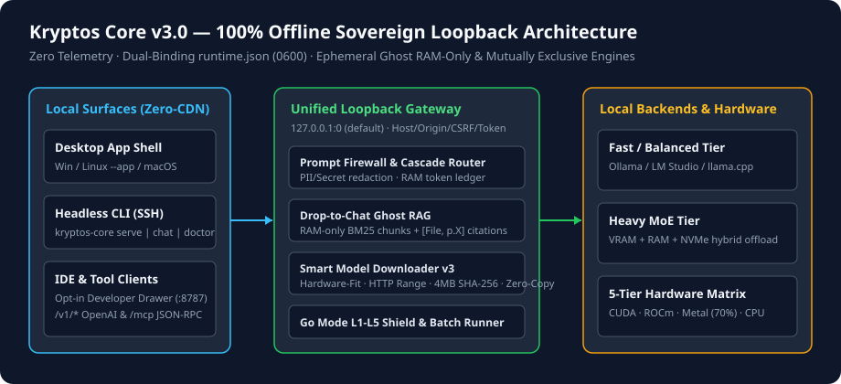
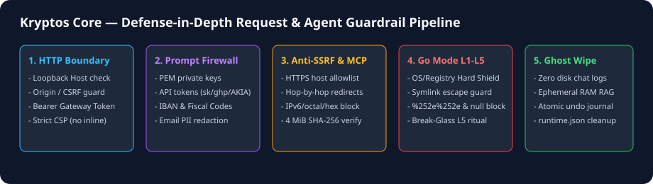
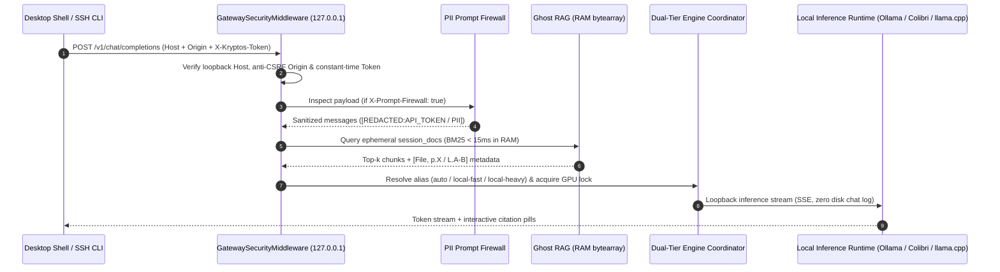

# Kryptos Core v3.0 — Sovereign Offline AI Workstation & Ephemeral Loopback Gateway

[](#quickstart-cross-platform)
[](SECURITY.md)
[](docs/SECURITY_AUDIT_V3.md)
[](docs/PRIVACY.md)
[](LICENSE)

**Kryptos Core** (from Ancient Greek *κρυπτός*, "hidden / protected") is a **100% offline, cross-platform AI workstation shell, headless SSH CLI, and unified OpenAI/MCP loopback gateway** engineered to maximize local compute utilization and enforce cryptographic, zero-telemetry data sovereignty across **Windows, Linux (CUDA / AMD ROCm / Wayland / X11 / Headless), and macOS (Apple Silicon Metal)**.

Instead of forwarding proprietary source code, contracts, or personal documents to third-party cloud APIs, Kryptos Core orchestrates open-weight models directly on your own silicon—combining **ephemeral port-0 loopback isolation**, **deterministic VRAM/RAM hardware-fit math**, **RAM-only Ghost RAG with byte-level zero-wipe**, and **5-tier OS/agent security guardrails**.



---

## Architectural Pillars & Engineering Specifications

### 1. Ephemeral Dual-Binding Loopback Topology (`127.0.0.1:0` + `0600` Discovery)
* **Zero Fixed-Port Exposure by Default:** On desktop startup (`kryptos-desktop`), the embedded ASGI server binds `127.0.0.1:0`, delegating ephemeral port selection to the OS kernel and eliminating port collisions or visible network clutter in the UI.
* **Owner-Only Atomic Runtime Discovery (`kryptos.runtime.v1`):** Publishes `<data_dir>/runtime.json` via atomic rename (`os.replace`) with strict owner-only permissions (`0600` on POSIX, `icacls /inheritance:r` ACL on Windows) and PID liveness validation (`psutil.pid_exists`), enabling `kryptos-core chat` and trusted local tools to discover the live session without scanning ports.
* **Opt-In Developer & IDE Gateway (`:8787`):** Toggling *Developer & IDE Integration* pins `127.0.0.1:8787` (with deterministic `8787–8795` fallback) and generates masked configuration snippets for **Cursor**, **Continue**, **Cline**, **OpenAI Python SDK**, and **HTTP JSON-RPC MCP** (`/mcp`, protocol `2025-03-26`).
* **Defense-in-Depth ASGI Boundary (`GatewaySecurityMiddleware`):**
  * Strict loopback `Host` header allowlist preventing DNS-rebinding attacks (`403`).
  * Strict `Origin` and `Sec-Fetch-Site` verification blocking cross-origin / `Origin: null` CSRF (`403`).
  * Constant-time (`secrets.compare_digest`) `X-Kryptos-Token` / `Authorization: Bearer` session authentication (`401`) and `Content-Type: application/json` enforcement on mutating endpoints (`415`).
  * Zero-CDN static delivery under `Content-Security-Policy: default-src 'self'; script-src 'self'; style-src 'self'; object-src 'none'; frame-ancestors 'none'` and `Cache-Control: no-store`.

### 2. Deterministic Hardware-Fit Sizing & Mutually Exclusive Engine Coordinator
* **Closed-Form Memory-Fit Estimator (`evaluate_model_fit`):** Before a single byte is downloaded or loaded, Kryptos Core computes total memory pressure including runtime overhead and KV-cache footprint:
  $$\text{Required}_{\text{GB}} = 1.15 \times \text{Weights}_{\text{GB}} + \text{KV}_{\text{GB}}(\text{ctx}, \text{quant})$$
  Classifies every catalog or custom GGUF model into `🟢 GPU Fluid` ($\le 90\%$ discrete VRAM, or $\le 70\%$ Unified Memory on Apple Silicon / Linux APUs), `🟡 Hybrid GPU + System RAM Offload`, or `🔴 Exceeds Safe Envelope`, estimating expected decode throughput (`tok/s`) from memory bandwidth.
* **Dual-Tier Mutual Exclusion (`EngineCoordinator`):** Arbitrates VRAM access between a low-latency **Fast / Balanced Tier** (`Ollama` / `llama.cpp`) and an optional **Heavy MoE Tier** (hybrid VRAM + System RAM + NVMe expert offloading via **Colibri**), preventing silent VRAM contention or swap thrashing, with automatic schema-failure cascade escalation (`auto` alias) and an in-memory token ledger per `X-App-Id`.

### 3. Supply-Chain Hardened Model Downloader & Zero-Copy Local Discovery
* **Two-Step Explicit Consent (`prepare -> start`):** Performs an authenticated `HEAD` pre-flight against an HTTPS host allowlist (`huggingface.co`, `cdn-lfs*.hf.co`, `registry.ollama.ai`), inspecting exact byte length, SPDX license, expected SHA-256 digest, and `>= 110%` free disk margin prior to user confirmation.
* **Hop-by-Hop Anti-SSRF Transport:** Disables automatic HTTP client redirects (`follow_redirects=False`), validating every redirect target against raw IPv4/IPv6, IPv6-mapped IPv4 (`::ffff:127.0.0.1`), decimal/octal/hex numeric IP encodings, cloud metadata endpoints (`169.254.169.254`), and URL userinfo spoofing.
* **Resumable Streaming Verification:** Downloads into `.downloads/<slug>.part` using `HTTP Range` (`206 Partial Content` + `ETag` continuity) and verifies **4 MiB streaming SHA-256** digests before atomic promotion.
* **Read-Only Zero-Copy Scanner (`kryptos-core models discover`):** Indexes existing local weights across `~/.ollama/models`, `~/.cache/huggingface/hub`, and `~/.lmstudio/models` with **`0 GB` disk duplication**.

### 4. Drop-to-Chat Ghost RAG (`0x00` Volatile RAM Wipe)
* Drag-and-drop `.pdf`, `.md`, `.txt`, `.py`, `.ts`, `.json`, `.csv`, or `.docx` (parsed safely via `defusedxml` against XXE/entity-expansion) directly into chat (`/api/chat/ephemeral-docs`).
* **Ghost Mode Guarantee:** Document chunks (`~600` tokens, `80`-token overlap) reside strictly inside mutable Python `bytearray` buffers in volatile RAM—never written to SQLite or temp files—and are explicitly overwritten with `0x00` bytes upon TTL expiry, session clear, or shutdown.
* **Sub-15ms Lexical + Hybrid Grounding:** Injects grounded blocks (`[DOC: file | p.X L.A-B]`) and renders interactive source-excerpt citation pills in the UI.

### 5. Autonomous Agent Containment: Go Mode `L1–L5`, Prompt Firewall & Sandbox
* **Deterministic PII & Secret Prompt Firewall (`prompt_firewall.py`):** Opt-in pre-dispatch filter (`X-Prompt-Firewall: true` or `KRYPTOS_PROMPT_FIREWALL=1`) redacting PEM private keys, API keys (`sk-*`, `ghp_*`, `AKIA*`), IBANs, tax IDs, and email addresses before requests hit `/v1/chat/completions` or `/mcp`.
* **Go Mode 5-Tier Guardrails (`go_mode.py`):** Enforces workspace containment, blocks null-byte and double-URL-encoded path traversal (`%252e%252e`), detects symlink escapes resolving outside the workspace root, maintains an atomic rollback journal, and guards OS/Registry/Credential roots with a **Level 5 Hard Shield** requiring a manual Break-Glass ritual.
* **Autonomous Orchestrator & Overnight Batch Runner:** Supports read-only host inspection out of the box, optional `--network none` rootless/Docker sandbox execution with slopsquatting package audits, and thermal/RAM-throttled overnight batch queues.



---

## Request & Execution Dataflow



---

## Built on Open Giants — Upstream Inference Credits

Kryptos Core is an **orchestration, security, hardware-sizing, and privacy workstation layer**. It does **not** redistribute third-party inference binaries or model weights in this repository, and gratefully acknowledges the upstream open-source projects that power local execution:

* **[Colibri](THIRD_PARTY_NOTICES.md)** *(Apache License 2.0)* — Optional Heavy MoE backend (`engines/colibri/`, gitignored) enabling high-efficiency hybrid VRAM + System RAM + NVMe Mixture-of-Experts inference on consumer and prosumer workstations.
* **[Ollama](https://github.com/ollama/ollama)** *(MIT License)* — Fast / Balanced local model serving (`OLLAMA_NO_CLOUD=1`, `OLLAMA_NOHISTORY=1`) and Zero-Copy manifest integration.
* **[llama.cpp](https://github.com/ggml-org/llama.cpp)** *(MIT License)* — Foundational `GGUF` quantization and cross-vendor tensor execution across CUDA, ROCm, Metal, AVX2, and ARM NEON.

See [`THIRD_PARTY_NOTICES.md`](THIRD_PARTY_NOTICES.md) for complete license notices and component attributions.

---

## Quickstart (Cross-Platform)

### Windows (PowerShell + `uv`)

```powershell
uv venv .venv --python 3.12
uv pip install -e ".[dev,ocr]" --python .venv\Scripts\python.exe
.\launcher\launch-app.ps1 -Mode ui-only
```

### Linux (Native WebKit2GTK / Isolated `--app` Window / Headless SSH)

```bash
uv venv .venv --python 3.12
uv pip install -e ".[dev,ocr]"
./scripts/install.sh          # Registers XDG desktop entry & probes WebKit2GTK / Chromium
kryptos-core doctor           # Inspects 5-tier GPU/CPU sizing & VRAM math
kryptos-core serve            # Headless loopback gateway (zero X11/Wayland dependency)
```

### macOS (Apple Silicon Metal / Intel)

```bash
uv venv .venv --python 3.12
uv pip install -e ".[dev,ocr]"
kryptos-desktop               # Native private_mode shell (70% Unified Memory cap enforced)
```

---

## 5-Tier Deterministic Hardware Sizing Matrix

| Tier | Hardware Profile | Default Quantized Target | `num_ctx` | GPU Offload Policy |
| :---: | :--- | :--- | :---: | :--- |
| **Tier A** | CPU-Only (`8 GB` RAM, `0 GB` VRAM) | `<= 3B Q4_K_M` | `2048` | `n_gpu_layers=0` (AVX2 / NEON) |
| **Tier B** | Entry Discrete GPU (`8 GB` VRAM CUDA/ROCm, `16 GB` RAM) | `7B–8B Q4_K_M` | `8192` | Full GPU (`-1`) + `q8_0` KV |
| **Tier C** | Enthusiast GPU (`16 GB` VRAM, `32 GB` RAM) | `14B–27B Q4_K_M` | `16384–32768` | Full GPU + Hybrid MoE Offload |
| **Tier D** | Workstation GPU (`24+ GB` VRAM, `64+ GB` RAM) | `32B–70B` / Heavy MoE | `32768` | Full GPU + Heavy MoE Tier |
| **Tier E** | Unified Memory (`16–32 GB` Apple Silicon / Linux APU) | `7B–14B Q4_K_M` | `8192–16384` | Hard-capped at **`70%`** Unified RAM |

Full mathematical derivations and throughput expectations are documented in [`docs/HARDWARE_COMPATIBILITY_MATRIX.md`](docs/HARDWARE_COMPATIBILITY_MATRIX.md).

---

## Verification, Security & Zero-Leak Gate

Run the complete test, adversarial security, and strict zero-leak audit suite locally before any build or contribution:

```bash
uv run pytest -m "not docker" -q
uv run python scripts/privacy_audit.py --strict
uv run python scripts/prepare_public_release.py --check
```

---

## Technical Documentation Index

* [`docs/ARCHITECTURE.md`](docs/ARCHITECTURE.md) — Internal subsystem topology, ASGI security state machine, Dual-Tier Coordinator, and Ephemeral Runtime Discovery
* [`docs/PRIVACY.md`](docs/PRIVACY.md) — Zero-telemetry invariants, RAM `bytearray` zero-wipe mechanics, and loopback network confinement
* [`docs/SECURITY_AUDIT_V3.md`](docs/SECURITY_AUDIT_V3.md) — Adversarial red-team suite results (`67/67` automated tests, SSRF/CSRF/Symlink/L5 Break-Glass verification)
* [`docs/HARDWARE_COMPATIBILITY_MATRIX.md`](docs/HARDWARE_COMPATIBILITY_MATRIX.md) — 5-Tier VRAM/RAM equations and Apple Silicon / ROCm / CUDA tuning
* [`docs/LINUX_GUIDE.md`](docs/LINUX_GUIDE.md) — CUDA, AMD ROCm sysfs detection, Wayland/X11 `--app` fallback, headless SSH CLI, and `AppImage` packaging
* [`docs/USER_GUIDE.md`](docs/USER_GUIDE.md) — Desktop workflows, Smart Downloader, Ghost RAG citations, Go Mode & Overnight Batch Runner
* [`docs/BENCHMARKS.md`](docs/BENCHMARKS.md) — Cold vs. warm TTFT, separated reasoning vs. visible `tok/s`, and reproducible Markdown cards
* [`THIRD_PARTY_NOTICES.md`](THIRD_PARTY_NOTICES.md) — Upstream engine credits (**Colibri**, **Ollama**, **llama.cpp**) & open-source dependency licenses
* [`SECURITY.md`](SECURITY.md) — Threat model & sanitized diagnostic bundle (`kryptos-core doctor --support-bundle`) disclosure policy
