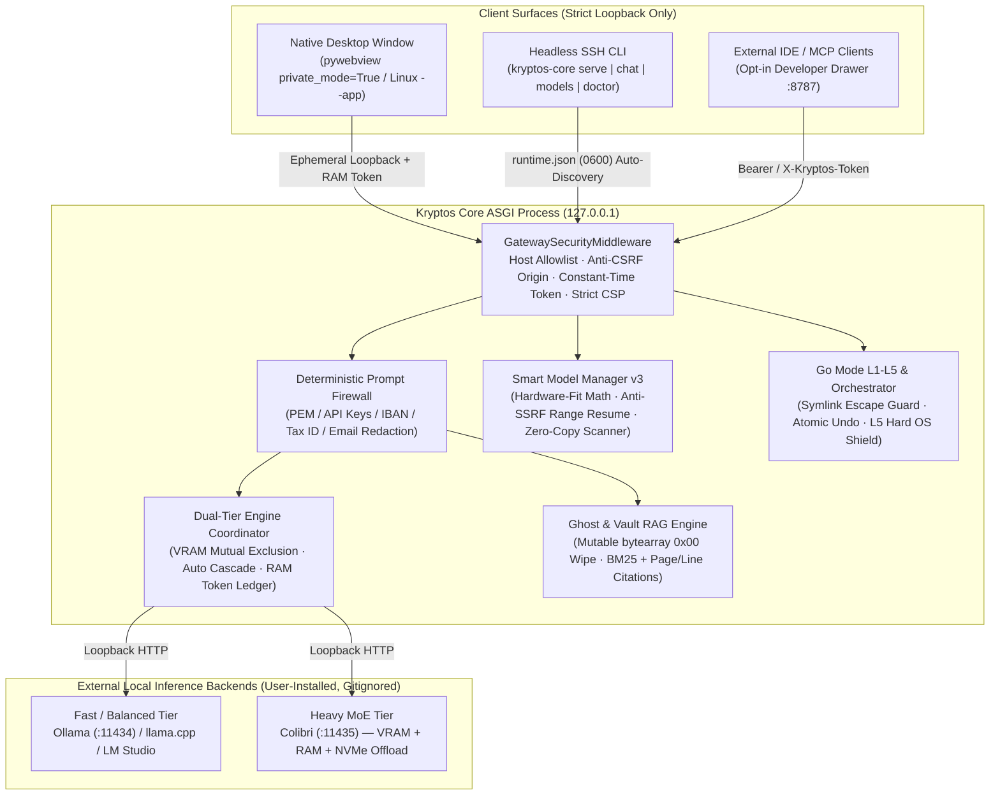

# Architecture Specification — Kryptos Core v3.0

> **Gateway:** FastAPI + Uvicorn ASGI (`127.0.0.1:0` default / `:8787` opt-in IDE mode) · **Desktop Shell:** `pywebview` (`private_mode=True`) + Linux `--app=` fallback · **Frontend:** React 18 + TypeScript + Tailwind CSS (100% Self-Hosted, Zero-CDN)

---

## 1. System Topology & Trust Boundaries

---

## 2. Core Subsystems Deep Dive

### 2.1 Cross-Platform Instance Lock & OS Path Resolution (`instance_lock.py`, `paths.py`)
* **Single-Instance Guarantee:** Uses Win32 named kernel mutex (`Local\KryptosCore_SingleInstance_v1`) on Windows—matching Inno Setup `AppMutex`—and non-blocking `fcntl.flock(LOCK_EX | LOCK_NB)` on a `0600` lockfile (`kryptoscore.lock`) on Linux and macOS, with zero unguarded `ctypes.WinDLL` imports on POSIX.
* **Canonical Storage Layout (`app_paths.v1`):**
  * **Windows:** `%LOCALAPPDATA%\KryptosCore\data` (`ephemeral_cache=True` disables persistent web cache).
  * **Linux (XDG):** `${XDG_DATA_HOME:-~/.local/share}/kryptoscore` and `${XDG_RUNTIME_DIR}` (`0700`).
  * **macOS:** `~/Library/Application Support/KryptosCore`.
  * **Portable Override:** Placing `portable.flag` beside the binary redirects state into `./data` across all three operating systems.

### 2.2 Dual-Binding Discovery (`runtime_state.py`)
* By default (`developer_gateway_enabled = False`), Kryptos Core binds `127.0.0.1:0`. Once the kernel assigns a free ephemeral port, `write_runtime_file()` atomically writes `<data_dir>/runtime.json` (`schema: "kryptos.runtime.v1"`) with owner-only ACLs (`0600`).
* Local consumers (`kryptos-core chat`, diagnostic scripts) invoke `read_active_runtime()`, which verifies both schema integrity and live process existence via `psutil.pid_exists(pid)` before connecting. On graceful exit (`atexit` / signal handler), `runtime.json` is unlinked.

### 2.3 Engine Coordinator & Safe Tuning (`engine/coordinator.py`, `services/tuning_bounds.py`)
* **VRAM Mutual Exclusion:** Prevents simultaneous residency of competing large backends unless explicitly supported by free VRAM headroom.
* **Virtual Model Routing:** Exposes `auto`, `local-fast`, `local-balanced`, and `local-heavy` over `/v1/chat/completions`, escalating automatically on structured-output validation failures in `auto` mode.
* **Deterministic Layer-1 Tuning Bounds:** Computes OS VRAM reserves and per-token KV-cache cost (`q8_0` vs `f16`) in `< 1 ms` to enforce `[min, recommended, max_safe]` context length and GPU layer bounds across Tiers A–E.

### 2.4 Ghost & Vault RAG (`rag/store.py`)
* **Ghost Mode (`MemoryEphemeralStore`):** Stores ingested chunks inside mutable `bytearray` buffers in process RAM. Clearing a session or shutting down overwrites every buffer byte with `0x00` before dereferencing, minimizing residual memory exposure.
* **Safe Document Parsers:** Supports `.txt`, `.md`, `.csv`, `.json`, `.py`, `.ts` (stdlib), `.docx` (stdlib `zipfile` + `defusedxml` blocking XXE/entity expansion), and `.pdf` (via optional `pymupdf` with exact `1`-based page mapping).

### 2.5 Autonomous Execution & Security Boundaries
* **Orchestrator (`workspaces/orchestrator/`):** Finite-state autonomous planner with circuit breakers, deterministic `code_audit` (detecting PyPI/npm slopsquatting and hardcoded secrets), `HostReadOnlyToolkit` safe default, and optional `--network none` container sandbox.
* **Go Mode (`services/go_mode.py`):** 5-tier human-in-the-loop file/command guardrails, atomic `.localllm_undo/` rollback journal, workspace symlink escape prevention (`_symlink_escapes_workspace`), and **Tier 5 Hard OS/Kernel Shield** protecting system binaries, boot configuration, and credential directories (`~/.ssh`, `~/.aws`, `.env`, `gateway.token`).
* **Overnight Batch Runner (`services/batch_runner.py`):** Checkpointed asynchronous batch processor with GPU thermal and system RAM watchdogs that pause execution before hardware throttling occurs.
